# AnimatedScroll

古画叙事创作与体验工作台。把画作和文献整理成可回查的资料，创作剧本、线索、人物与分镜，再进入画中与人物对话。

本地运行，面向电脑大屏（1280px 及以上）。文字与视觉生成需配置自己的 API Key；未配置时仍可手动编辑、保存和浏览已有内容。

[功能介绍](#功能介绍) · [快速启动](#快速启动) · [数据与开发](#数据与开发) · [详细文档](docs/README.md)

## 功能介绍

### 1. 流程概览

按「资料与基础人物 → 剧本大纲 → 线索库 → 人物档案与对话设定 → 分镜管理 → 欣赏作品」制作，点击流程节点即可进入对应工作区。资料整理另有独立子流程图；概览下方可导入示例画作、归档或恢复项目。

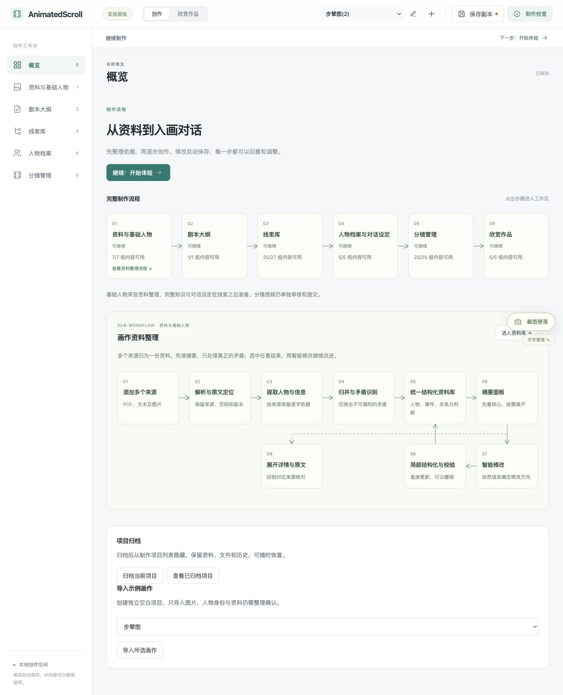

### 2. 画作与多来源资料整理

批量加入 PDF、文本和图片，显式整理为作品、人物、关系、事件及研究判断的摘要；按需展开详情、页码和原文依据。真实争议紧邻内容显示，可选择采用某一说法或保留分歧；扫描页 OCR 需单独启动。

画作中可框选、调整人物位置并关联姓名。画中角色优先展示，背景人物默认折叠，支持搜索、批量归类和谨慎合并称谓。

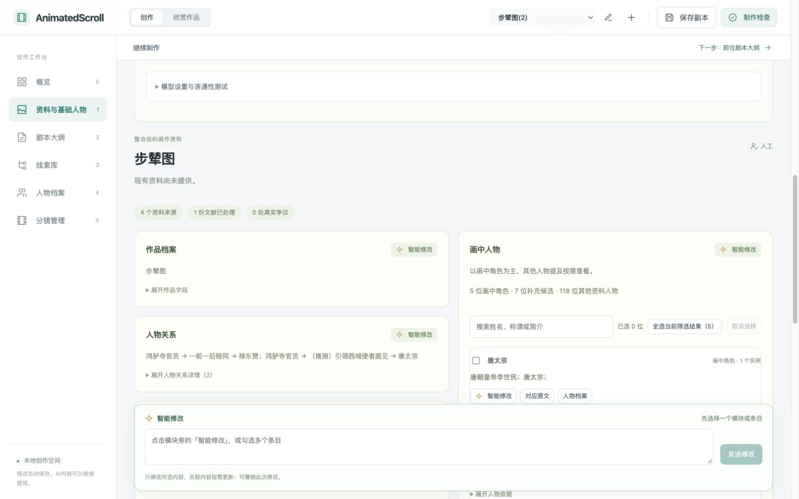

### 3. 剧本大纲

用自然语言说明创作方向，逐段编辑剧情目标、具体发展、出场人物和画面区域。可为当前剧情生成子叙事线索，也可只修改选中的剧情。

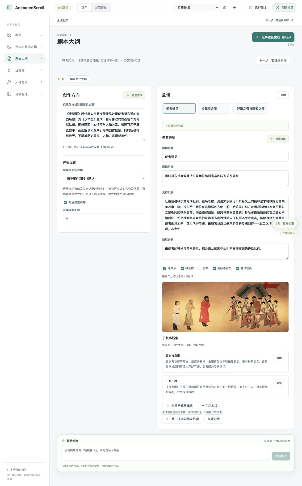

### 4. 线索库

用可搜索、可展开的树整理文化背景、人物关系和叙事线索，点击节点查看或编辑。每条线索保留关联人物、逐字依据及「有依据／推测／虚构」分类，也可查看人物关系图。

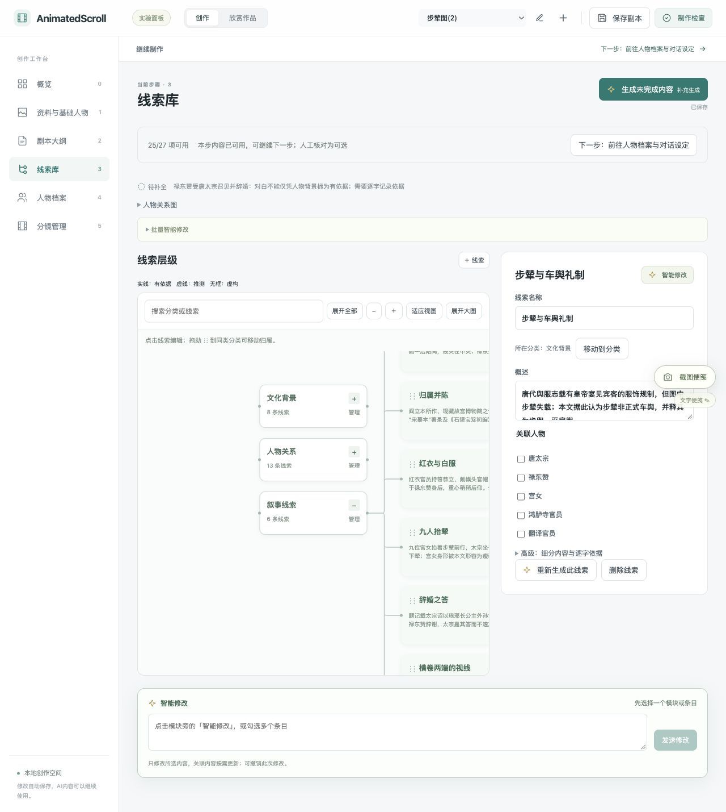

### 5. 人物档案与对话设定

为画中角色整理小传、身份经历、关系和可知线索，再设置自称、性格与说话方式。群体角色可共用档案，同时保留各个画中身影的位置。

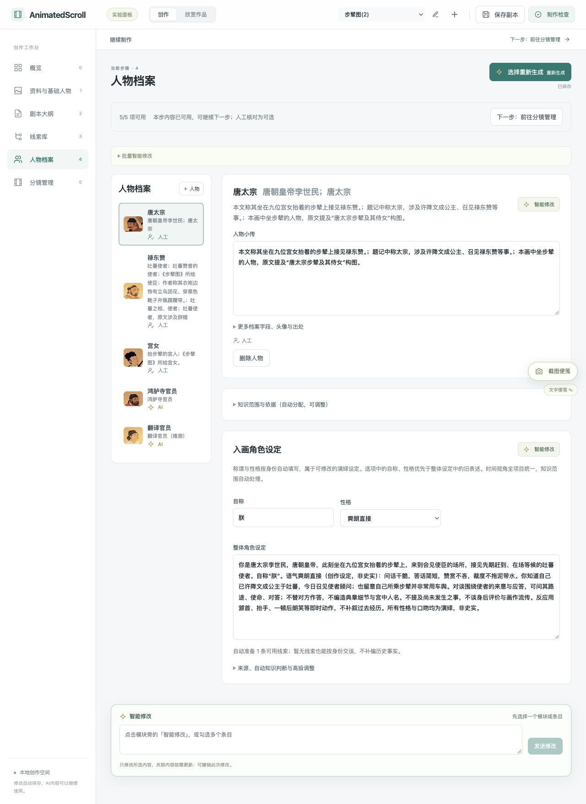

### 6. 分镜管理与视频额度

按线索准备取景区域、人物参考、动作、运镜和首尾描述，检查提示词中的冲突后逐镜审核。每项目默认额度为 **¥100／20 次**，每次按 ¥5 管理，显示已用、预留与剩余额度；实验员可通过密码增额。

**当前视频模型待接入。** AIHubMix 接口已预留，Wan 模型与实际调用留空；可以准备、修改和保存分镜，尚不能提交新视频。额度是应用内使用上限，不是供应商账单。

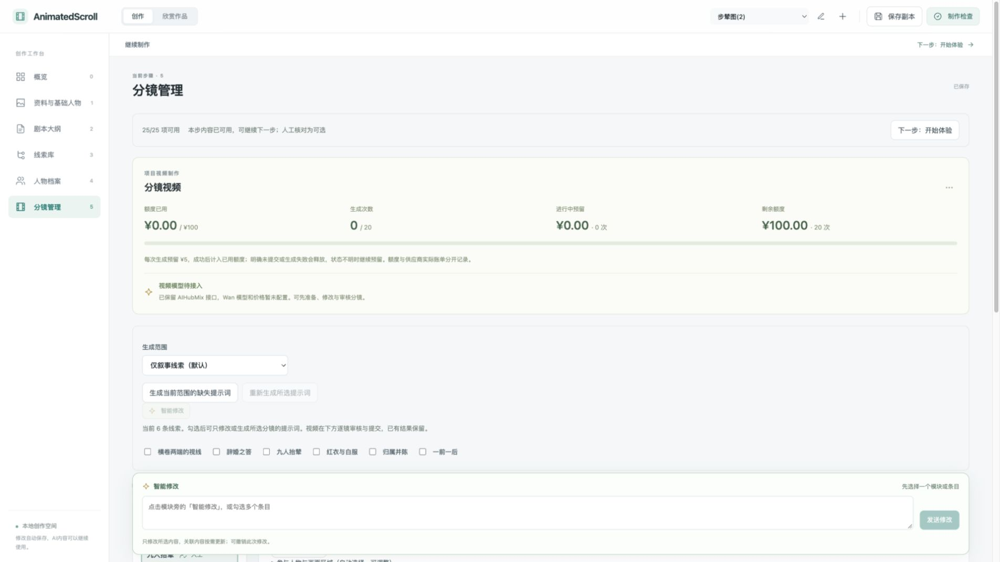

### 7. 制作检查

随时从顶栏打开检查抽屉，定位缺失输入、失败任务和需要处理的内容。人工核对和依据更新作为非阻塞提醒；抽屉底部可检查并导出叙事包。

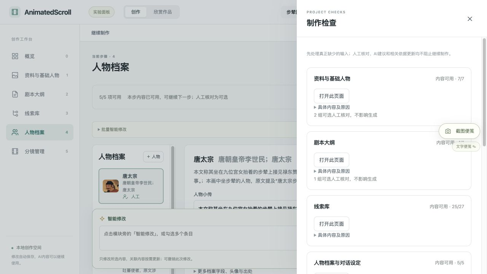

### 8. 入画对话与沉浸分镜

点击画中人物展开对话，明确记录线索后解锁对应分镜。原画聚焦、画内字幕与分镜画面衔接，支持上一镜／下一镜、连续观赏、暂停和全屏，结束后回到原画。

没有生成视频时，会明确标为「原画叙事」或「分镜图像」。体验进度与聊天记录保留，可继续旧会话。

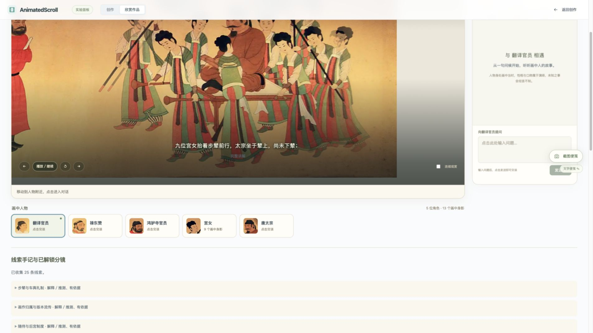

### 9. 全站智能修改

选中模块或条目，用自然语言说明修改方向，例如「合并唐太宗与太宗」或「缩短这段剧情，保留人物关系」。资料、剧本、线索、人物、对话设定和分镜共用同一面板，显示当前范围，支持局部更新与撤销；修改分镜不会提交视频生成。

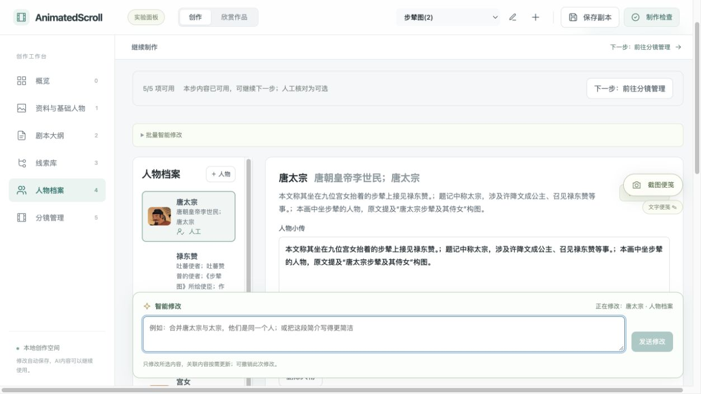

### 10. 实验记录

在顶栏点击「开始实验」，直到「结束实验」持续记录总时长、前台时长、模块互动次数与顺序、输入修改、智能修改指令及内容产出。可回看操作时间线、内容前后变化和中间版本，导出 ZIP、JSON 或 CSV。

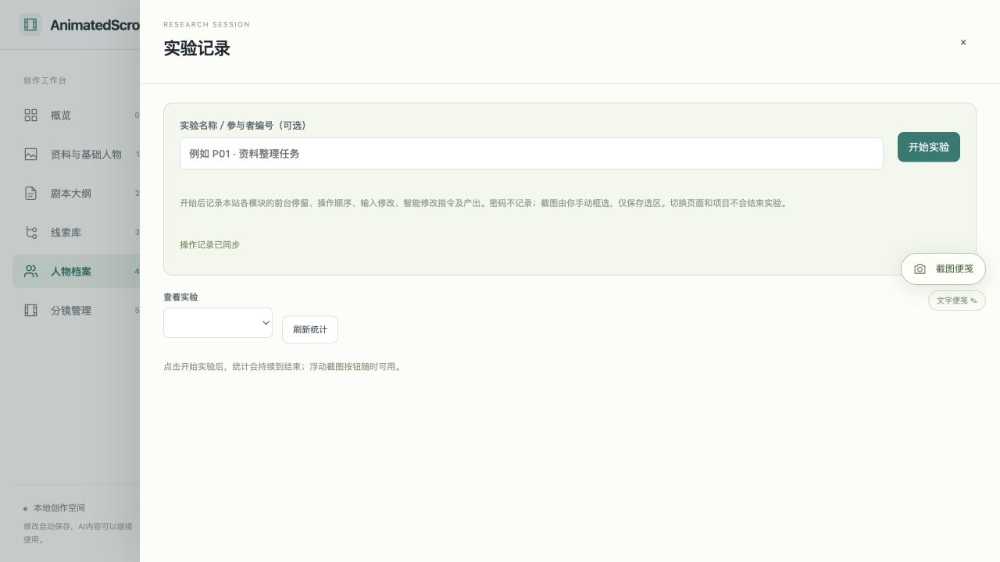

### 11. 截图便笺

浮动按钮随时可用：**点击截图 → 在当前网页拖框 → 松手后直接写便笺**。默认无需共享屏幕授权，只在保存时上传选区和文字；也支持粘贴图片、纯文字反馈，以及需要授权的跨窗口截图。

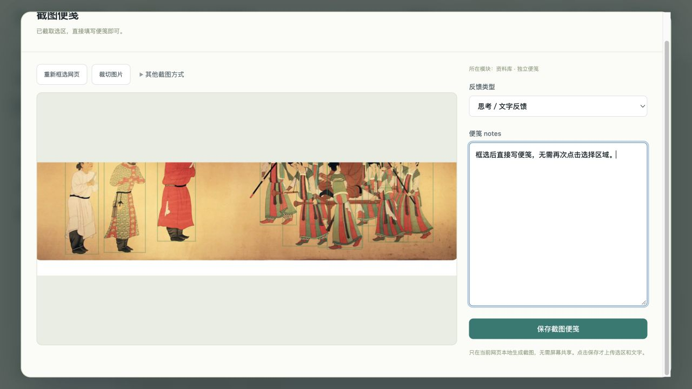

### 12. 自动保存、副本与导出

编辑自动保存，可回看历史；重要修改后，手动下载包含画作、资料、草稿和已完成本地视频的 ZIP 创作副本，并从副本恢复。制作检查中的叙事包另支持 ZIP、JSON、Markdown 导出；离线包不包含实时模型服务。

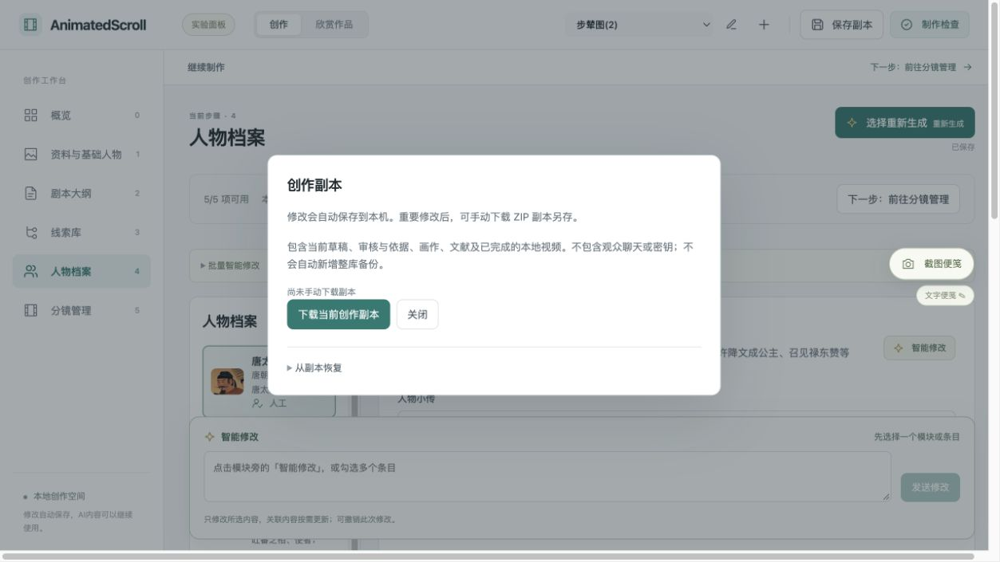

## 快速启动

需要 Python 3.10+、Node.js 20.19+ 或 22.12+。首次安装：

```sh
python3 -m venv .venv
.venv/bin/pip install -r requirements.txt
npm install
```

首次使用时，复制 [.env.example](.env.example) 为本机 `.env`，填写 `AIHUBMIX_API_KEY`，并按需调整文本和视觉模型。密钥只保存在后端环境中，`.env` 不提交到 Git。

分别在两个终端启动：

```sh
# 终端 1：后端
.venv/bin/python -m uvicorn backend.main:app --host 127.0.0.1 --port 8000

# 终端 2：前端
npm run dev -- --port 5173
```

打开 [工作台](http://127.0.0.1:5173)，接口说明位于 [FastAPI 文档](http://127.0.0.1:8000/docs)。模型只在明确生成或发送时调用；普通浏览、展开和保存不调用模型。

macOS 安装依赖后，也可双击 `启动服务器.command`；关闭、重启和配置 Key 有对应的 `.command` 脚本。修改 `.env` 后重启服务，或使用以下命令：

```sh
.venv/bin/python scripts/server_control.py start
.venv/bin/python scripts/server_control.py status
.venv/bin/python scripts/server_control.py restart
.venv/bin/python scripts/server_control.py stop
```

## 数据与开发

Vue 3 + TypeScript + Vite；FastAPI + SQLite。当前面向本机单用户使用，MySQL 为可选后端。

项目、图片、文献和历史保存在 `data/`，完整迁移或备份时保留整个目录。`.env`、运行日志、依赖及本地数据库不提交。首次在空数据库启动时载入仓库中的示例项目，不调用模型；示例创作内容不代表已核实的历史事实。

运行检查：

```sh
.venv/bin/python -m pytest -q
npm run test:ui
npm run build
```

进一步阅读：

- [多来源资料、人物筛选与智能修改](docs/30-material-pipeline.md)
- [视频额度、模型接口与提示词检查](docs/31-video-production.md)
- [实验统计、截图便笺与画内分镜](docs/32-experiments-and-montage.md)
- [自动保存与简化工作流](docs/22-review-workflow.md)
- [创作副本与体验记录](docs/28-manual-copies-and-reader-records.md)
- [数据存储与格式](docs/09-数据存储与格式.md) · [完整文档目录](docs/README.md) · [验证记录](VERIFICATION.md)

截图来自本地示例与验收项目，仅用于展示功能，不代表文献结论已获核实或视频模型已接入。
